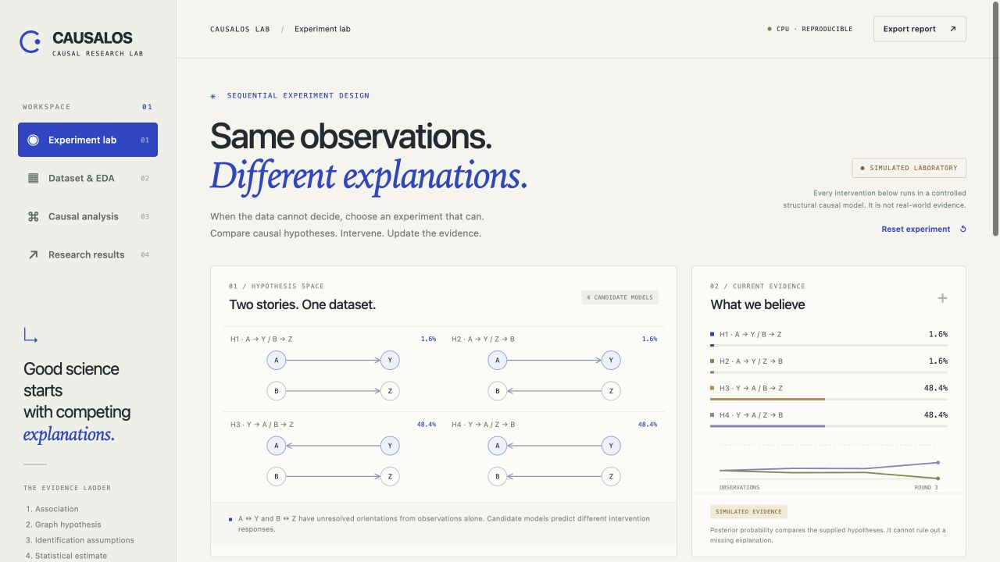
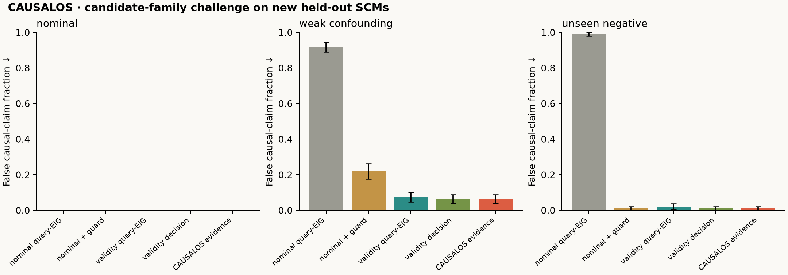
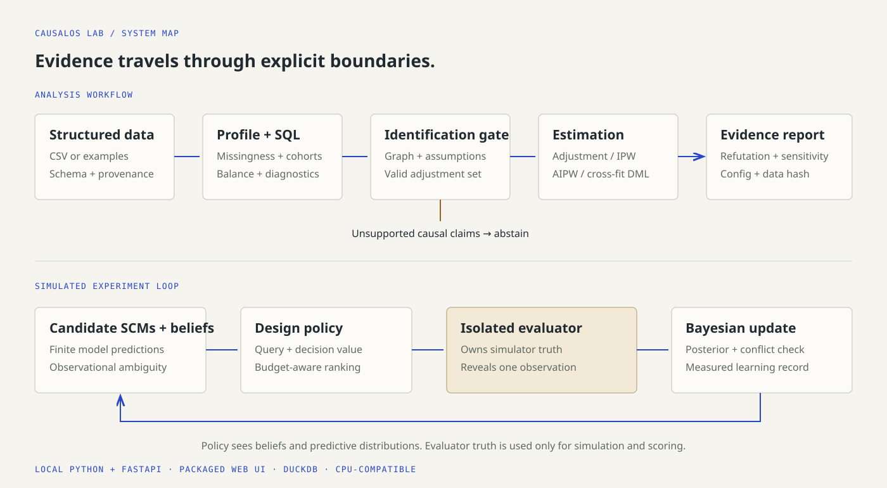

<p align="left"><strong>CAUSALOS LAB</strong> · Open causal research instruments</p>

# Ask what would change.

CAUSALOS is a local causal-analysis and experimental-design laboratory. Compare causal explanations, inspect identifying assumptions, estimate eligible effects, challenge them, and choose a simulated experiment that could resolve uncertainty.

**Research preview · v0.1.0.** Causal conclusions remain conditional on explicit assumptions. Observational structure search returns graph hypotheses. The intervention replay is a labeled simulation, not a real-world experiment.



[Try the interactive public replay](https://nazeeh111.github.io/CausalOS/demo/) · [Watch the 20-second launch film](assets/launch/brag.mp4) · [Read the research report](docs/research.md)

The public replay runs Bayesian experiment selection in your browser using recorded simulator observations. Built-in dataset analyses are precomputed; run the Python application below for new datasets and edited causal questions.

## Run the laboratory

Python 3.11 or newer. No model API key, GPU or paid service is required.

```bash
git clone https://github.com/nazeeh111/CausalOS.git
cd CausalOS
python -m venv .venv
source .venv/bin/activate
python -m pip install '.[dev,discovery]'
causalos serve
```

Open [localhost:8000](http://127.0.0.1:8000). On Windows activate with `.venv\Scripts\activate`. The server binds to your own computer by default. Uploads are processed in memory; this release has no hosted data service or accounts.

## A complete evidence workflow

1. Select a reproducible synthetic or real example, or import a CSV. Inspect missingness, duplicates, distributions, correlations and SQL cohorts.
2. State a binary-treatment, continuous-outcome average-effect question. Construct or import a candidate graph and its adjustment set.
3. Explicitly accept the substantive assumptions. The engine validates the backdoor criterion and blocks unsupported cases before estimation.
4. Compare regression, propensity weighting, augmented weighting and cross-fitted double machine learning. Inspect intervals, covariate balance, overlap, placebo and subset checks, and omitted-confounder sensitivity.
5. Explore competing structural models in the experiment workspace. Rank affordable interventions, simulate a result and replay posterior learning.
6. Export an HTML or JSON evidence record with assumptions, limitations, dataset fingerprint and software versions.

## Reproduce an analysis

```bash
causalos example confounded --out artifacts/example
causalos profile artifacts/example/data.csv --out artifacts/profile.json
causalos analyze artifacts/example/data.csv \
  --question artifacts/example/question.json \
  --out artifacts/analysis.json --report artifacts/report.html
causalos replay --steps 4 --out artifacts/replay.json
pytest -q
```

The example question records its synthetic study assumptions explicitly. For your own data, confirming a checkbox does not make an assumption true. Establish timing, measurement and study design from domain knowledge. The engine conservatively abstains on partial graphs and latent confounding; it does not implement general causal identification.

## Experimental-design research

The original experimental component is a small, inspectable budget-aware policy over competing finite Gaussian structural models. Its score combines expected improvement in a defined decision, information about the queried effect, optional graph information and experiment cost. We optimize policy weights on training seeds, select on validation seeds and evaluate once on disjoint test seeds.

The benchmark compares random, uncertainty, full-model information gain, query information gain, decision-value and ablated policies. It records cost, effect error, structural uncertainty, calibration, decision regret, interval coverage, false claims and abstention. This is a controlled testbed with known predictive likelihoods, not a state-of-the-art claim about arbitrary causal discovery. Goal-oriented information gain is established prior work.

The first study's optimized blend **exactly matched the query-EIG baseline**, with no advantage. A separate follow-up policy adds explicit hidden-confounding alternatives and selects experiments that can challenge the original causal family. Across 96 fresh weak-confounding test seeds it reduced false causal claims from **21/96 to 6/96** compared with nominal query-EIG using the same posterior and guard. The paired 95% bootstrap interval for the reduction was 7.29–23.96 percentage points. It tied the validity decision-value baseline and showed no improvement in the stronger unseen-negative scenario. All 4,352 held-out episodes, including negative results, are published.



```bash
causalos benchmark --out artifacts/benchmark
causalos benchmark --study evidence --out artifacts/evidence-benchmark
```

Read the [technical research report](docs/research.md), [analysis methods](docs/analysis.md), [foundations and prior art](docs/foundations.md), [data provenance](examples/README.md), [verification record](docs/verification.md) and [contribution guide](CONTRIBUTING.md). The evidence policy is an original finite-model implementation and measured investigation, with a limited novelty claim. Published-method comparisons are explicitly scoped criterion adaptations, not reproductions of large neural systems.

[Inspect a complete exported NSW evidence report](https://nazeeh111.github.io/CausalOS/nsw-evidence.html), including its assumptions, SQL diagnostics, estimator intervals, study provenance and exact configuration. The corresponding [machine-readable record](docs/nsw-evidence.json) is included in the source.



## Scientific boundaries

- A fitted association, a causal hypothesis, identification, estimation and experimental verification are distinct evidence states.
- No effect is estimated solely because a graph-search algorithm produced an arrow.
- Confidence intervals quantify sampling uncertainty conditional on estimator assumptions. They do not include all graph or unmeasured-confounding uncertainty.
- Simulation can evaluate a policy against known truth. It cannot establish that the same intervention works in people, institutions or other real systems.
- The current analysis engine supports complete numeric inputs and a binary 0/1 treatment. Individual counterfactuals for uploaded data, arbitrary latent-variable identification and production multi-user hosting are outside this release.
- In an intentionally false-assumption stress test, an omitted common cause defeated the observational gate in 12/12 cases. Software cannot verify untestable scientific assumptions. The historical NSW case has 445 actual observations; IHDP validation uses one outcome replication and dependent row splits, so broad calibration is not established.

The separately labeled structural-model counterfactual tool holds inferred disturbances fixed inside each supplied demo SCM. Competing models can disagree; this does not identify a real person's counterfactual outcome.

## License and attribution

Original code is [MIT licensed](LICENSE). Libraries and datasets retain their own licenses. Research foundations include [DoWhy](https://github.com/py-why/dowhy), [EconML](https://github.com/py-why/EconML), [causal-learn](https://github.com/py-why/causal-learn), [Causica](https://github.com/microsoft/causica), [BoTorch](https://github.com/meta-pytorch/botorch), and the studies cited in the research report. Runtime dependency and data attribution are documented separately.
