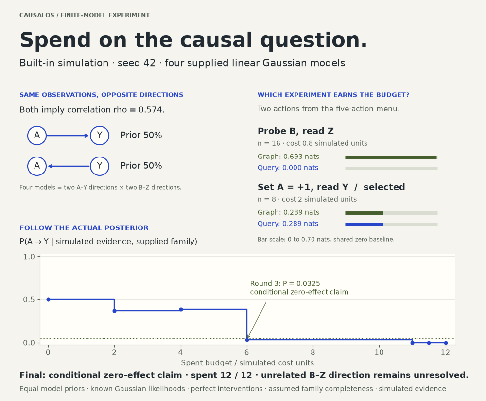
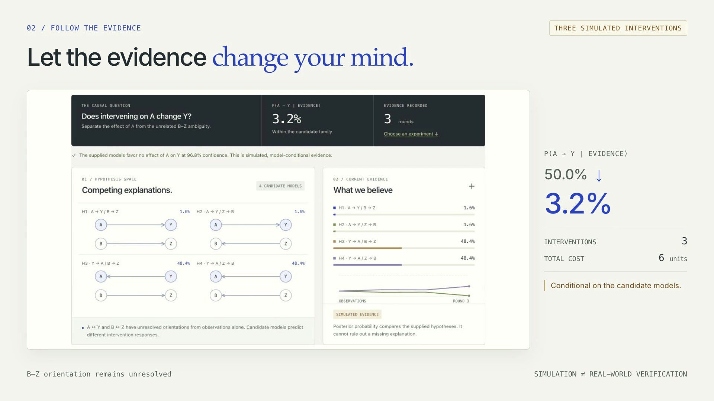
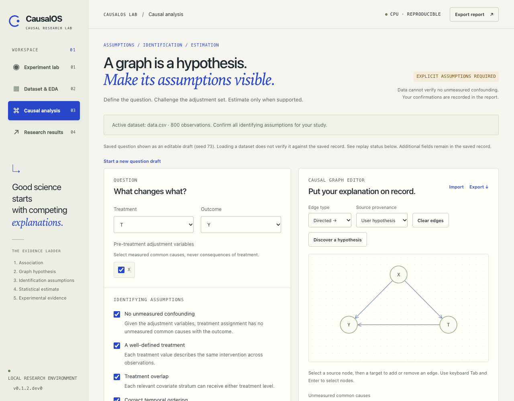
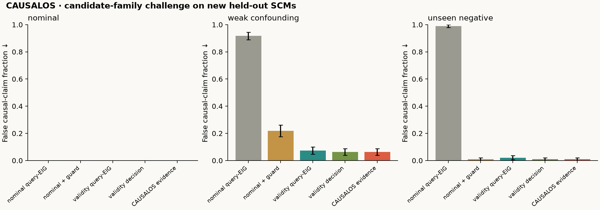
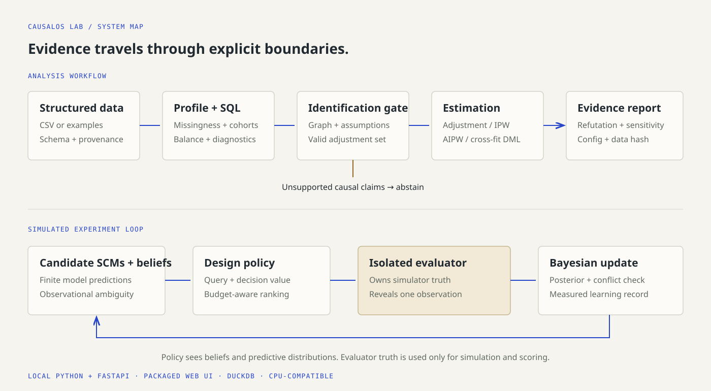

# CausalOS

**Compare causal explanations. Choose an experiment.**

CausalOS is a local causal-analysis and experimental-design laboratory. Compare causal explanations, inspect identifying assumptions, estimate eligible effects, challenge them, and choose a simulated experiment that could resolve uncertainty.

**Research preview · unreleased v0.1.2.dev0.** Causal conclusions remain conditional on explicit assumptions. Observational structure search returns graph hypotheses. The intervention replay is a labeled simulation, not a real-world experiment.

<picture>
  <source media="(max-width: 600px)" srcset="docs/presentation/question-first-mobile.png">
  
</picture>

**Resolving an unrelated edge need not resolve the causal question.** In the built-in seed-42 scenario, both A → Y and Y → A explain the same observational distribution. The cheaper B–Z probe gives more whole-model information, yet no information about A → Y. The selected A interventions update that question instead. The final zero-effect claim depends on the supplied four-model family, equal prior, known Gaussian likelihoods, perfect interventions and the decision rule. It is a simulated decision, not real-world causal identification or evidence of general policy advantage.

[Follow the completed replay](docs/presentation/README.md) · [Raw states and provenance](docs/presentation/provenance.json) · [Vector figure](docs/presentation/question-first.svg) · [Actual current laboratory](docs/presentation/laboratory-current.png)

[Try the interactive public replay](https://nazeeh111.github.io/CausalOS/demo/) · [Run the laboratory](#run-the-laboratory) · [Read the research report](docs/research.md)

[](https://nazeeh111.github.io/CausalOS/launch/)

[Inspect the experiment table](assets/lab-v0.1.1-experiments.png) · [Mobile preview](assets/lab-v0.1.1-mobile.png) · [v0.1.1 review and verification](docs/review-v0.1.1.md)

The public replay runs Bayesian experiment selection in your browser using recorded simulator observations. Built-in dataset analyses are precomputed; run the Python application below for new datasets and edited causal questions.

## Run the laboratory

Python 3.11 or newer. No model API key, GPU or paid service is required.

```bash
git clone https://github.com/nazeeh111/CausalOS.git
cd CausalOS
python -m venv .venv
source .venv/bin/activate
python -m pip install '.[dev,discovery]'
causalos serve
```

Open [localhost:8000](http://127.0.0.1:8000). On Windows activate with `.venv\Scripts\activate`. The server binds to your own computer by default. Uploads are processed in memory; this release has no hosted data service or accounts.

## A complete evidence workflow

1. Select a reproducible synthetic or real example, or import a CSV. Inspect missingness, duplicates, distributions, correlations and SQL cohorts.
2. State a binary-treatment, continuous-outcome average-effect question. Construct or import a candidate graph and its adjustment set.
3. Explicitly accept the substantive assumptions. The engine validates the backdoor criterion and blocks unsupported cases before estimation.
4. Compare regression, propensity weighting, augmented weighting and cross-fitted double machine learning. Inspect intervals, covariate balance, overlap, placebo and subset checks, and omitted-confounder sensitivity.
5. Explore competing structural models in the experiment workspace. Rank affordable interventions, simulate a result and replay posterior learning.
6. Export an HTML or JSON evidence record with assumptions, limitations, dataset fingerprint and software versions.

## Save, reopen and replay an analysis



*The reopened seed-73 synthetic record shows T → Y adjusted for X and its recorded graph. [Capture context](docs/reopened-capture.md).*

`causalos analyze` now returns a versioned analysis-run bundle. One immutable
record contains the question, assumptions, requested or default seed, input digest,
numerical source/runtime identity, estimates and any refusal. The original causal
engine and scientific limitations are unchanged. Raw rows are omitted by default:

```sh
causalos analyze data.csv --question question.json --out run.json --report evidence.html
causalos run-open run.json --report reopened.html
causalos run-replay run.json --csv data.csv --out replay-check.json
```

Use `--include-data` on `analyze` only when you want raw scalar rows embedded in
the saved file. Such a file can replay without `--csv`. Keep it private unless
sharing the rows is appropriate. Reports always omit the bundle's embedded raw
table; questions, column names, results and aggregate diagnostics can still be
sensitive. An omitted dataset cannot be recovered from its digest.

The Causal analysis screen has **Save record**, **Open record** and **Replay saved
analysis** controls. Including raw rows is an explicit checkbox, off by default.
The report exports the saved snapshot; editing the current question or loading a
new dataset does not rewrite that record. Opening a file displays saved estimates
or refusals and marks externally supplied results unverified. Replay requires the
same original input and recorded numerical source/runtime, then compares all
result/refusal fields with relative tolerance 1e-9 and absolute tolerance 1e-12.
Mismatches, unavailable data and changed software are explicit outcomes, never a
silent replacement. A blocked causal analysis is a valid replayable record.

New API routes are `POST /api/runs/open`, `/api/runs/save` and `/api/runs/replay`,
accepting `{"run": "<original run JSON text>"}` with optional matching `data` records.
The API returns `run` as opaque JSON text; retain/send/download that text without
parsing and reserializing it in JavaScript. Display-only estimates are separate.
This preserves exact JSON number types and digests, including large integers. Save defaults
to omitting raw rows; `include_data:true` is required to embed them. `/api/analyze`
retains its existing result fields and adds `run`. `/api/report` accepts that
`run` and checks any supplied data/question against it; independent `analysis`
objects are rejected. Existing simulation-only reports remain supported.

Content hashes detect inconsistency, not authorship, malicious re-signing, or
causal validity. The local API remembers at most 16 computed/replayed records in
memory. Imported, evicted or restarted-session records are explicitly unverified
until replay succeeds; no persistent server database or authentication promise is
implied. Matching recorded versions/binaries/platform does not guarantee identical
hardware floating-point behavior, so replay still checks the actual outputs.
New local run/report outputs publish complete files without overwriting existing
paths. Run files contain JSON only and never execute code or choose server paths.


Run admission uses one detached scalar snapshot before DataFrame inference. The
snapshot's exact integers, booleans, nulls, row order and column order define its
identity. Integers not exactly representable by this float64 numerical engine
are refused, including9007199254740993; use an explicit audited transformation
rather than silent rounding. Existing DataFrames can only bind the scalar values
they currently contain, not recover values lost before calling CausalOS. Pandas
missing values normalize to null; infinities are refused instead of silently
becoming missing values.
Analysis/replay CSV input now parses finite numeric lexemes explicitly, preserves
integer and boolean values, and treats empty cells as null; other text, including
NA, remains text. CSV and run files are limited to24 MiB.

All local API POST requests have a24 MiB **complete HTTP JSON envelope** limit,
checked on declared and actual streamed bytes before JSON parsing. This includes
opaque run-text escaping and any optional matching rows; a file close to the file
limit can require the CLI instead. Unknown run/report request fields are refused.
Replay compares software and all integer/boolean/structural fields exactly.
Floating tolerance is restricted to named numerical measurements (estimates,
interval endpoints, overlap/balance and sensitivity outputs); confidence levels,
sensitivity-grid parameters and assumptions compare exactly.

## Reproduce an analysis

```bash
causalos example confounded --out artifacts/example
causalos profile artifacts/example/data.csv --out artifacts/profile.json
causalos analyze artifacts/example/data.csv \
  --question artifacts/example/question.json \
  --out artifacts/analysis.json --report artifacts/report.html
causalos replay --steps 4 --out artifacts/replay.json
pytest -q
```

The example question records its synthetic study assumptions explicitly. For your own data, confirming a checkbox does not make an assumption true. Establish timing, measurement and study design from domain knowledge. The engine conservatively abstains on partial graphs and latent confounding; it does not implement general causal identification.

## Experimental-design research

The original experimental component is a small, inspectable budget-aware policy over competing finite Gaussian structural models. Its score combines expected improvement in a defined decision, information about the queried effect, optional graph information and experiment cost. We optimize policy weights on training seeds, select on validation seeds and evaluate once on disjoint test seeds.

The benchmark compares random, uncertainty, full-model information gain, query information gain, decision-value and ablated policies. It records cost, effect error, structural uncertainty, calibration, decision regret, interval coverage, false claims and abstention. This is a controlled testbed with known predictive likelihoods, not a state-of-the-art claim about arbitrary causal discovery. Goal-oriented information gain is established prior work.

The first study's optimized blend **exactly matched the query-EIG baseline**, with no advantage. A separate follow-up policy adds explicit hidden-confounding alternatives and selects experiments that can challenge the original causal family. Across 96 fresh weak-confounding test seeds it reduced false causal claims from **21/96 to 6/96** compared with nominal query-EIG using the same posterior and guard. The paired 95% bootstrap interval for the reduction was 7.29–23.96 percentage points. It tied the validity decision-value baseline and showed no improvement in the stronger unseen-negative scenario. All 4,352 held-out episodes, including negative results, are published.



```bash
causalos benchmark --out artifacts/benchmark
causalos benchmark --study evidence --out artifacts/evidence-benchmark
```

Read the [technical research report](docs/research.md), [analysis methods](docs/analysis.md), [foundations and prior art](docs/foundations.md), [data provenance](examples/README.md), [verification record](docs/verification.md) and [contribution guide](CONTRIBUTING.md). The evidence policy is an original finite-model implementation and measured investigation, with a limited novelty claim. Published-method comparisons are explicitly scoped criterion adaptations, not reproductions of large neural systems.

[Inspect a complete exported NSW evidence report](https://nazeeh111.github.io/CausalOS/nsw-evidence.html), including its assumptions, SQL diagnostics, estimator intervals, study provenance and exact configuration. The corresponding [machine-readable record](docs/nsw-evidence.json) is included in the source.



## Scientific boundaries

- A fitted association, a causal hypothesis, identification, estimation and experimental verification are distinct evidence states.
- No effect is estimated solely because a graph-search algorithm produced an arrow.
- Confidence intervals quantify sampling uncertainty conditional on estimator assumptions. They do not include all graph or unmeasured-confounding uncertainty.
- Simulation can evaluate a policy against known truth. It cannot establish that the same intervention works in people, institutions or other real systems.
- The current analysis engine supports complete numeric inputs and a binary 0/1 treatment. Individual counterfactuals for uploaded data, arbitrary latent-variable identification and production multi-user hosting are outside this release.
- In an intentionally false-assumption stress test, an omitted common cause defeated the observational gate in 12/12 cases. Software cannot verify untestable scientific assumptions. The historical NSW case has 445 actual observations; IHDP validation uses one outcome replication and dependent row splits, so broad calibration is not established.

The separately labeled structural-model counterfactual tool holds inferred disturbances fixed inside each supplied demo SCM. Competing models can disagree; this does not identify a real person's counterfactual outcome.

## License

Original code is [MIT licensed](LICENSE). Libraries and datasets retain their own licenses; see [data provenance](examples/README.md) for dataset-specific terms.
