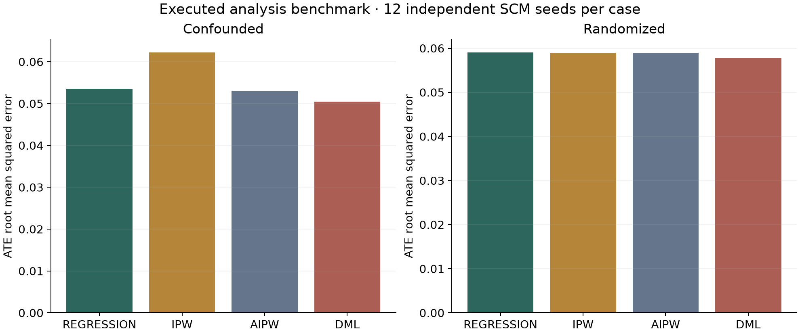

# Analysis: what the evidence can support

CAUSALOS reports an effect only after the user supplies a causal graph, an
adjustment set and explicit scientific assumptions. Statistical fit does not
validate those assumptions. A status of "identified" means **identified under the
accepted assumptions**, never experimentally proven from observational data.

## The identification boundary

The supported question is the sample-population average treatment effect (ATE)
of a binary treatment on a numeric outcome, identified by observed-covariate
backdoor adjustment. Treatment must be 0/1. The user must accept conditional
exchangeability, consistency, positivity, temporal ordering, no interference,
measurement validity and selection ignorability. Each assumption has an inline
definition. All are untestable in full from the supplied table.

The engine checks that the graph is acyclic, every adjustment variable is
observed, no selected adjustment variable descends from treatment, and the
adjustment set d-separates treatment and outcome in the graph with treatment's
outgoing arrows removed. D-separation is computed using ancestral moralization,
which correctly detects collider paths opened by adjustment. Learned graphs
require additional scientific confirmation; a learned direction alone never
authorizes identification.

A partially oriented graph, latent-variable graph, unblocked backdoor path,
unsupported data type, missing input, rank-deficient design or severe empirical
overlap failure causes abstention. This is deliberately conservative: the engine
does not implement the general ID algorithm, frontdoor identification, instruments,
partial identification, longitudinal treatment or transportability. Some effects
identifiable by stronger methods therefore remain blocked.

A wrong graph with incorrectly confirmed assumptions can still produce a wrong
conditional estimate. No observational software can eliminate this limitation.
The evaluation includes a deliberate hidden-confounder stress test to expose it.

## Four estimators, with different requirements

| Method | Implementation | What the interval assumes |
|---|---|---|
| Regression | statsmodels OLS, additive treatment and adjustment variables | Correct additive conditional mean, independent observations, HC3 robust asymptotic normal approximation |
| Propensity IPW | Scaled logistic treatment model, Horvitz–Thompson score | Correct propensity, overlap, no consequential clipping bias; 80 stratified pairs-bootstrap nuisance refits by default, percentile interval |
| Augmented IPW | Logistic propensity plus separate linear outcome regressions | Point estimate is doubly robust; displayed simple influence-score interval additionally needs both parametric nuisance models correct or negligible nuisance bias |
| Double machine learning | Five-fold stratified cross-fitting, random-forest outcomes, logistic propensity, interactive-regression-model orthogonal AIPW score | Overlap, nuisance-rate/product-error conditions and asymptotic normality; finite-sample coverage is measured, not promised |

The DML target is the ATE, rather than the partially linear residual-on-residual
coefficient that can weight heterogeneous effects differently. Propensities are
clipped to [0.01, 0.99] for numerical stability and the affected fraction is
reported. More than 5% of fitted scores beyond those bounds blocks estimation.
The fraction outside [0.05, 0.95] and weighted effective sample sizes are shown.
These are empirical checks, not proof of population positivity.

All four estimators are established methods. The research contribution is
in experimental design and evidence handling.

## Challenges to a conclusion

A seeded treatment-permutation regression is a placebo check for gross estimator
artifacts. A seeded 80% subset regression checks instability. Neither validates
unconfoundedness. One permutation is not an omnibus statistical test.

The sensitivity grid uses the single omitted-variable linear-model bias formula:

    |bias| = sqrt(R2(Y,U | T,X) * R2(T,U | X) / (1 - R2(T,U | X)))
             * sqrt(SSE(Y | T,X) / SSE(T | X))

Both bias signs are shown at specified partial R-squared strengths. This is a
model-based point-estimate bias envelope, not an identified-effect interval or
a measurement of hidden confounding. It follows
[Cinelli and Hazlett (2020)](https://doi.org/10.1111/rssb.12348).

Individual counterfactual outcomes are not identified by these ATE analyses and
are not generated. The separately labeled SCM laboratory supports simulation
under its own explicit structural assumptions.

## SQL, EDA and provenance

The profiling module registers a memory copy of the observed table in DuckDB.
It never silently drops, imputes, rescales or deduplicates rows. It executes
missingness/distinct-count queries, sample moments/quantiles, treatment cohorts
and pooled-variance standardized mean differences. Correlations are descriptive.
Exact SQL and a content/schema fingerprint accompany every profile. The
pandas-based fingerprint is version-dependent; raw example files also retain
conventional SHA-256 hashes.

[SQL profiling](../sql/profile.sql) and [cohorts](../sql/cohorts.sql)
contain executable NSW count, missingness, earnings-cohort and balance analyses.
Tests execute these on actual packaged data, including 185 treated and 260
control records. [The study artifact](../examples/analysis-results.json) contains
executed full profiles, effect estimates, confidence intervals and study records.

## Dataset provenance and reproducibility

The real-data case is the 445-person Dehejia–Wahba restricted randomized National
Supported Work sample, distributed as nsw_mixtape by
[causaldata](https://nickch-k.r-universe.dev/causaldata/doc/manual.html#nsw_mixtape).
The package declares MIT plus its copyright file. Attribution and a raw-byte
hash are retained in the packaged resources/data directory. Only the row index
and constant source label are removed; all 445 participants remain. The outcome
is 1978 earnings in historical dollars. No real true ATE or individual effects
are observed. This selected historical study does not establish a current policy
forecast for a broader population.

The semi-synthetic case uses established IHDP NPCI replication 1 from
[CEVAE](https://github.com/AMLab-Amsterdam/CEVAE/tree/master/datasets/IHDP).
The upstream [loader](https://github.com/AMLab-Amsterdam/CEVAE/blob/master/datasets.py)
defines treatment, factual outcome, counterfactual outcome, mu0, mu1 and 25
covariates. CAUSALOS separates observed inputs from evaluator-only truth before
learning. Nuisance models fit training rows; factual validation loss selects
random-forest leaf size. Heldout AIPW scores use test rows. No test outcome or
truth selects a nuisance model. True conditional means are read only by the
final evaluator.

The archived IHDP repository has no license declaration. CAUSALOS therefore
redistributes no IHDP bytes and supplies a checksum-verified downloader for
independent local evaluation. Check applicable terms before use. Ten row
resplits of one replication are dependent, not ten independent outcome
realizations; they cannot establish broad benchmark superiority.

    python examples/fetch_ihdp.py /tmp/causalos-ihdp.csv
    MPLCONFIGDIR=/tmp/causalos-mpl OPENBLAS_NUM_THREADS=1 OMP_NUM_THREADS=1 python examples/evaluate.py --ihdp /tmp/causalos-ihdp.csv --seeds 12

The evaluation also works without the IHDP argument for fully bundled
synthetic/real-data reproduction. It generates numerical JSON and a chart from
the executed analyses. The synthetic study uses independent repeated SCM seeds
and reports bias, RMSE, empirical interval coverage, coverage Monte Carlo standard
errors and abstention on declared invalid cases. A deliberately false-assumption
case demonstrates the inability to detect an omitted unrecorded confounder.

## Method references

- [Sharma and Kiciman (2020), DoWhy](https://arxiv.org/abs/2011.04216): modeling, identification, estimation and refutation as separate steps.
- [Chernozhukov et al., Double/debiased machine learning](https://arxiv.org/abs/1608.00060): orthogonal scores and cross-fitting.
- [EconML](https://github.com/py-why/EconML): established orthogonal causal ML, useful for extensions; not required at runtime for this small CPU implementation.
- [Cinelli and Hazlett (2020)](https://doi.org/10.1111/rssb.12348): partial-R-squared omitted-variable sensitivity.
- [Louizos et al. (2017), CEVAE](https://arxiv.org/abs/1705.08821): source context for IHDP; CAUSALOS does not reproduce CEVAE training.

## Executed results

These are measurements from the saved run, not illustrative numbers. The small repeated-seed count limits precision.

| SCM | Estimator | ATE RMSE | Nominal 95% interval coverage | Wilson interval for the coverage fraction |
|---|---|---:|---:|---|
| confounded | regression | 0.0535 | 100.0% | [75.8%, 100.0%] |
| confounded | ipw | 0.0622 | 100.0% | [75.8%, 100.0%] |
| confounded | aipw | 0.0529 | 100.0% | [75.8%, 100.0%] |
| confounded | dml | 0.0504 | 100.0% | [75.8%, 100.0%] |
| randomized | regression | 0.0590 | 91.7% | [64.6%, 98.5%] |
| randomized | ipw | 0.0590 | 91.7% | [64.6%, 98.5%] |
| randomized | aipw | 0.0590 | 91.7% | [64.6%, 98.5%] |
| randomized | dml | 0.0578 | 91.7% | [64.6%, 98.5%] |

Each SCM used 12 independent seeds and 1,200 observations per seed. All 36 declared collider, hidden-confounding and unresolved-direction cases abstained. In the deliberately misspecified case with an unrecorded confounder and falsely confirmed exchangeability, all 12 regression intervals excluded the true zero effect. This is a failure to detect false assumptions, not a valid causal finding.

IHDP replication 1, ten dependent row resplits: heldout AIPW ATE mean absolute error **0.2265**, mean PEHE **0.6161**, and intervals covering the heldout true ATE in 10/10 splits. Shared underlying observations make these dependent; no binomial coverage guarantee or comparative superiority follows.

### Observed NSW EDA and conditional effects

The 445 rows contain no missing values in the analyzed columns. Fifteen fully repeated measured records are retained: these may be distinct participants with the same recorded features and zero earnings, so deduplication would require participant identity evidence. Independent-unit inference remains a study-design assumption.

The DuckDB cohort query returned control mean earnings of **$4,554.80** (260 participants) and treated mean earnings of **$6,349.14** (185 participants), an unadjusted difference of **$1,794.34**. The largest absolute unweighted covariate standardized mean difference was 0.3040 for no-degree status; the largest absolute IPW-weighted difference was 0.0090. Balance improvement is not proof of exchangeability.

Estimated propensities ranged from 0.1948 to 0.6758; no scores were clipped. Weighted effective sample sizes were 175.99 treated and 251.50 controls. The absence of empirical poor overlap does not establish population positivity.

| Estimator | Conditional ATE, historical dollars | Approximate 95% interval |
|---|---:|---|
| regression | 1676.34 | [333.15, 3019.54] |
| ipw | 1612.43 | [158.46, 3008.18] |
| aipw | 1619.00 | [302.78, 2935.22] |
| dml | 1540.21 | [142.25, 2938.17] |

At assumed partial R-squared strengths of 0.1 for both treatment and outcome, the regression sensitivity envelope spans approximately $272 to $3,080. This is an assumed hidden-bias envelope, not a confidence interval. No real-data ground-truth ATE is available for error scoring.

The numerical artifact retains every seed, interval, selected IHDP hyperparameter, test-partition fingerprint, exact dataset hash and runtime package versions.
